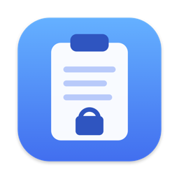
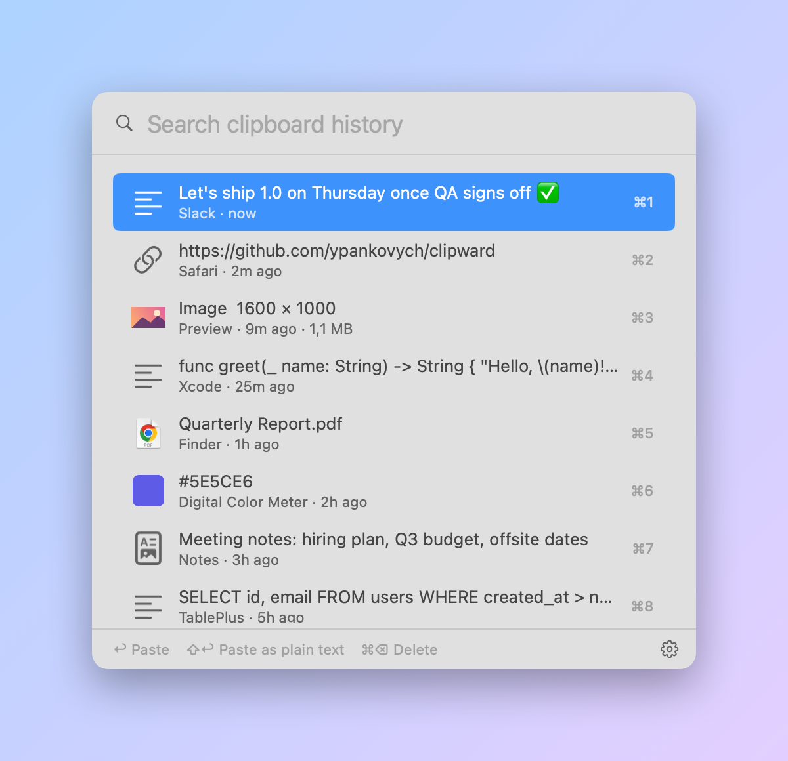
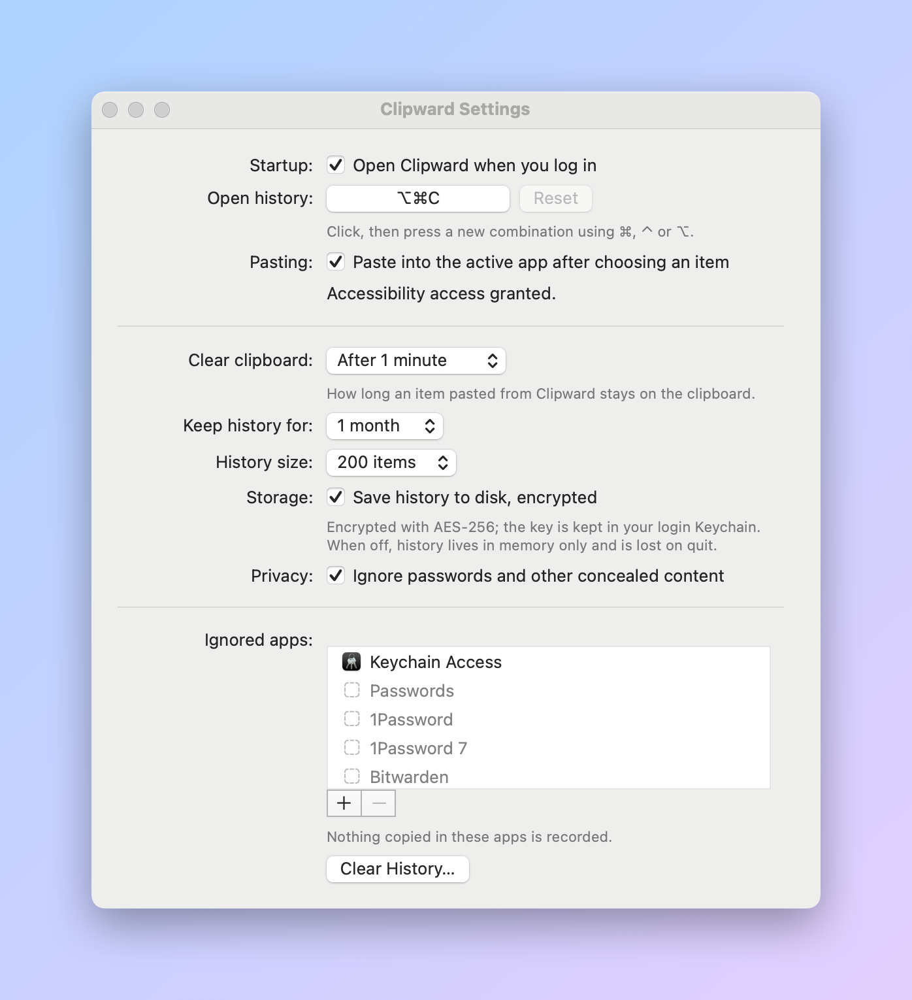

# Clipward

[](https://github.com/ypankovych/clipward/releases/latest)
[](https://github.com/ypankovych/clipward/actions/workflows/ci.yml)
[](LICENSE)


Clipward is a small, private clipboard manager for macOS. Try the live demo at **[clipward.dev](https://clipward.dev)**. It remembers everything you copy
(text, images, files, colors, anything) and brings it back with <kbd>⌥ Option</kbd> + <kbd>⌘ Command</kbd> + <kbd>C</kbd>.

It is built for people who copy passwords, tokens and other secrets: history is encrypted on disk,
password-manager copies are never stored, and anything you paste from the history is wiped from
the clipboard after a minute.

Clipward works on **macOS 10.13 High Sierra and later**, on both Apple silicon and Intel Macs.

<picture>
  <source media="(prefers-color-scheme: dark)" srcset="docs/screenshots/history-dark.png">
  
</picture>

* [Features](#features)
* [Install](#install)
* [Usage](#usage)
* [Settings](#settings)
* [Security and privacy](#security-and-privacy)
* [FAQ](#faq)
* [Building from source](#building-from-source)
* [Contributing](#contributing)
* [License](#license)

## Features

* **Every data type**: plain and rich text, links, images, files and folders, colors, and
  app-specific formats. Every format of every item is kept, so pasting from the history works
  exactly like the original copy.
* **Keyboard first**: search as you type, paste with <kbd>↩</kbd>, pick any of the first nine
  items with <kbd>⌘</kbd> + <kbd>1</kbd>–<kbd>9</kbd>.
* **Secure by default**: encrypted history, an auto-clearing clipboard, and password managers
  respected out of the box.
* **Native and minimal**: AppKit, no web views, no third-party dependencies. It looks like
  part of macOS in light and dark mode.
* **Wide compatibility**: one universal app for macOS 10.13 through the current release.
* **Free and open source** under the MIT license. No accounts, no network access, no telemetry.

## Install

1. Download **Clipward-x.y.z.dmg** from the [latest release](https://github.com/ypankovych/clipward/releases/latest).
2. Open it and drag **Clipward** into **Applications**.
3. Open Clipward from Applications. It lives in the menu bar; there is no Dock icon.

Clipward isn't notarized by Apple yet, so the first launch is blocked by Gatekeeper.
To allow it:

* **macOS 15 Sequoia and later**: try to open the app once, then go to
  *System Settings › Privacy & Security* and click **Open Anyway** next to the Clipward message.
* **macOS 14 and earlier**: right-click (or <kbd>⌃</kbd>-click) Clipward in Applications, choose
  **Open**, then confirm.
* Or, from Terminal: `xattr -dr com.apple.quarantine /Applications/Clipward.app`

You can check the download against the `.sha256` file published with each release.

## Usage

1. Press <kbd>⌥ Option</kbd> + <kbd>⌘ Command</kbd> + <kbd>C</kbd>, or click the menu bar icon,
   to open the history.
2. Type to search. Every word you type must match.
3. Choose an item:

| Action | Keys |
| --- | --- |
| Paste the selected item | <kbd>↩</kbd> or click |
| Paste as plain text (no formatting) | <kbd>⇧</kbd> + <kbd>↩</kbd> |
| Paste item 1–9 directly | <kbd>⌘</kbd> + <kbd>1</kbd> … <kbd>9</kbd> |
| Move the selection | <kbd>↑</kbd> <kbd>↓</kbd>, <kbd>Page Up</kbd> <kbd>Page Down</kbd> |
| Delete the selected item | <kbd>⌘</kbd> + <kbd>⌫</kbd> |
| Clear the search, then close | <kbd>esc</kbd> |
| Open Settings | <kbd>⌘</kbd> + <kbd>,</kbd> |

To stop recording for a while, choose **Pause Recording** in the menu bar menu. The icon dims
while paused.

## Settings

<picture>
  <source media="(prefers-color-scheme: dark)" srcset="docs/screenshots/settings-dark.png">
  
</picture>

| Setting | Default | |
| --- | --- | --- |
| Open Clipward when you log in | off | Uses Login Items on macOS 13+, a user launch agent on older systems. |
| Open history shortcut | <kbd>⌥⌘C</kbd> | Click it and press any combination with <kbd>⌘</kbd>, <kbd>⌃</kbd> or <kbd>⌥</kbd>. |
| Paste into the active app | on | Needs Accessibility access (see the [FAQ](#why-doesnt-it-paste-into-my-app)). |
| Clear clipboard | after 1 minute | Never, or 15 s to 10 min. |
| Keep history for | 1 month | 1 day to 3 months, or forever. |
| History size | 200 items | 50 to 1000. |
| Save history to disk, encrypted | on | When off, history is kept in memory only. |
| Ignore passwords and other concealed content | on | |
| Ignored apps | Keychain Access, Passwords, 1Password, Bitwarden | Copies made in these apps are never recorded. |

Settings are stored in `~/Library/Preferences/io.github.ypankovych.Clipward.plist`, so they can
also be changed with `defaults`. For example:

```sh
defaults write io.github.ypankovych.Clipward clearClipboardAfter -float 30   # seconds, 0 = never
```

## Security and privacy

* **Encrypted at rest.** Each history item is stored in
  `~/Library/Application Support/Clipward/History` as AES-256-CBC + HMAC-SHA256 (encrypt-then-MAC)
  ciphertext. The random 512-bit key lives in your login Keychain, not on disk. Files are readable
  only by your user and are excluded from Time Machine. If the Keychain can't be reached, Clipward
  keeps history in memory and **never** falls back to plaintext.
* **Auto-clearing clipboard.** When you paste from the history, Clipward removes the item from the
  clipboard after the time you choose (default 1 minute). It also clears it when it quits.
  Anything you copied in the meantime is left alone.
* **Password managers respected.** Copies marked with the
  [nspasteboard.org](http://nspasteboard.org) concealed or transient types are never recorded.
  This covers 1Password, Bitwarden, KeePassXC, KeeWeb, macOS Passwords and others.
* **Ignored apps** and **Pause Recording** for anything else.
* **Offline.** Clipward makes no network connections and collects nothing.

Found a vulnerability? See [SECURITY.md](SECURITY.md).

## FAQ

### Why doesn't it paste into my app?

Pasting means simulating <kbd>⌘V</kbd>, which macOS only allows for apps with Accessibility
access. Open *System Settings › Privacy & Security › Accessibility* and turn on **Clipward**
(Settings has a shortcut button for this). Until then, choosing an item copies it and you press
<kbd>⌘V</kbd> yourself.

### macOS keeps asking for Keychain access or Accessibility again after an update

macOS ties these permissions to the app's code signature. Release builds are ad-hoc signed for now,
so each new version looks like a different app. Click **Always Allow** in the Keychain prompt and
re-enable Clipward under Accessibility after updating.

### The shortcut conflicts with another app

<kbd>⌥⌘C</kbd> is also Finder's *Copy as Pathname* and opens developer tools in some browsers.
While Clipward runs, its shortcut wins. Pick a different one in Settings if you need those.
Shortcuts follow the physical key position, so they keep working when you switch keyboard layouts.

### How do I see which types an app puts on the clipboard?

Use [Pasteboard-Viewer](https://github.com/sindresorhus/Pasteboard-Viewer), then add the app to
**Ignored apps** if you don't want its copies recorded.

### Is anything ever sent anywhere?

No. Clipward has no networking code and no analytics.

## Building from source

Only the Xcode Command Line Tools are needed (`xcode-select --install`); Xcode is optional.

```sh
git clone https://github.com/ypankovych/clipward.git
cd clipward
Scripts/build-app.sh     # build/Clipward.app: universal binary, ad-hoc signed
Scripts/test.sh          # tests for the core logic
Scripts/make-dmg.sh      # build/Clipward-<version>.dmg (needs Python 3)
Scripts/screenshots.sh   # regenerates docs/screenshots from the real UI
```

To sign with your own identity (this avoids repeated Keychain and Accessibility prompts):

```sh
SIGN_IDENTITY="Developer ID Application: Your Name (TEAMID)" Scripts/build-app.sh
```

A self-signed "Code Signing" certificate from Keychain Access works too.

<details>
<summary>Why the scripts call <code>swiftc</code> instead of <code>swift build</code></summary>

`Package.swift` is there so the project opens in Xcode. The scripts call `swiftc` directly because
SwiftPM in some Command Line Tools installs fails with `unable to lookup item 'PlatformPath'`, and
because it makes the universal, back-deployed bundle easy to produce. macOS older than 10.14.4 has
no Swift runtime, so the build bundles Apple's back-deployment runtime in `Contents/Frameworks`;
newer systems ignore it.
</details>

### Project layout

| | |
| --- | --- |
| `Sources/ClipwardCore` | UI-free logic: clipboard monitoring, capture policy, analysis, encrypted storage, history, pasting, settings |
| `Sources/Clipward` | The app: hot key, login item, menu bar item, history popup, settings window |
| `Tests/ClipwardCoreTests` | Test runner for the core, run with `Scripts/test.sh` |
| `Scripts` | Build, DMG, icon and screenshot scripts |
| `website` | The [clipward.dev](https://clipward.dev) site with the in-browser demo; `website/deploy.sh` publishes it |

## Contributing

Bug reports, ideas and pull requests are welcome. Please read [CONTRIBUTING.md](CONTRIBUTING.md)
first.

## License

[MIT](LICENSE) © Yaroslav Pankovych
